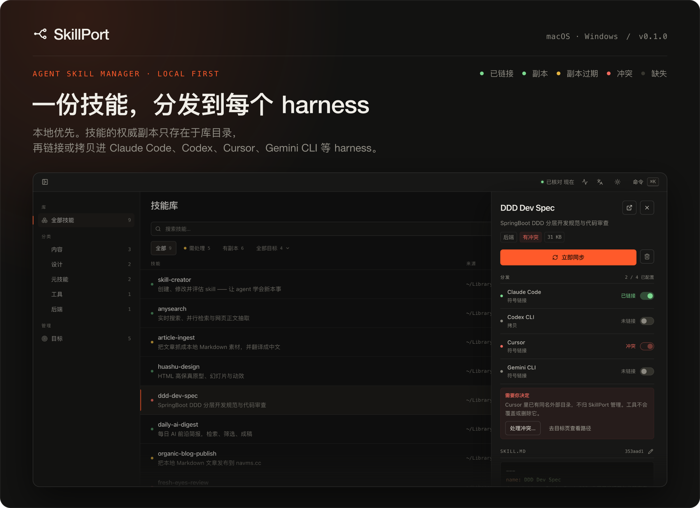
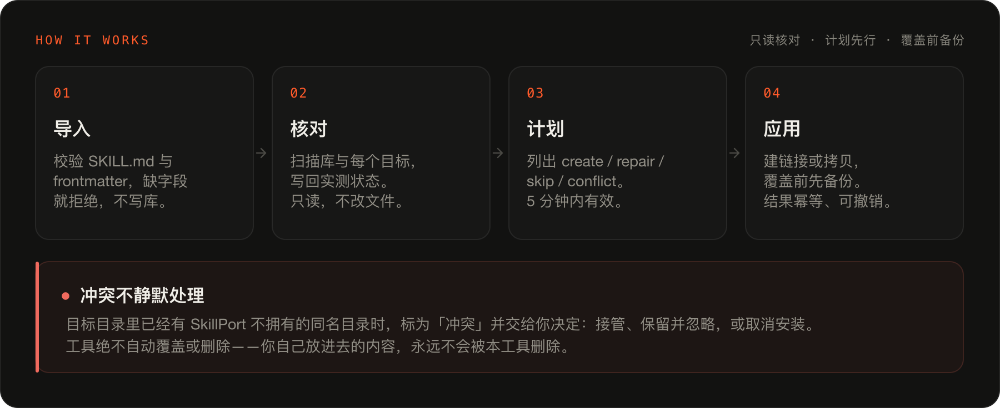
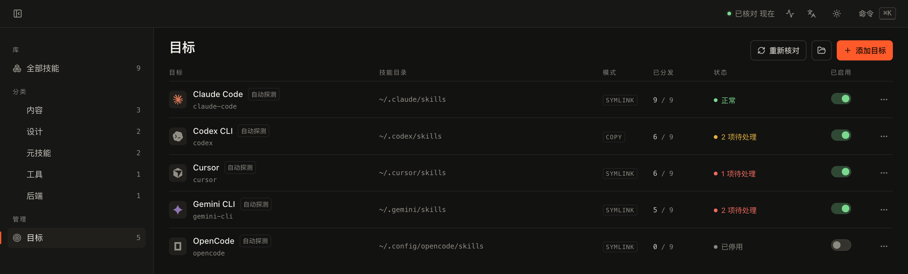
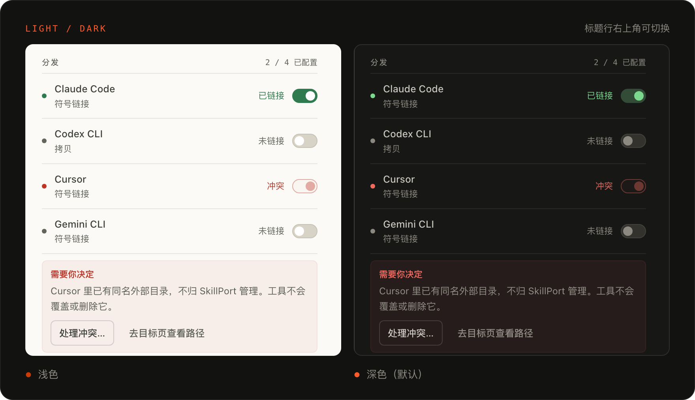

<p align="center">
  
</p>

# SkillPort

**一个技能库，分发到每个 Agent harness。**

<p>
  
  
  
  
</p>

*A local-first Agent Skill manager for macOS and Windows. One library, distributed to every harness.*

一个 Skill 就是一个含 `SKILL.md` 的目录，frontmatter 里至少有 `name` 和 `description`，可以带脚本、资源和子目录。
SkillPort 只保留库里的这一份，再把它链接或拷贝进 Claude Code、Codex CLI、Cursor、Gemini CLI、OpenCode
等任意 harness。

---

## 它解决什么

Claude Code、Codex CLI、Cursor、Gemini CLI 各自从自己的目录读技能。同一个技能要喂给几个 harness，
就只能复制几份——改了一处，其余几处悄悄过期；复制得越多，越说不清哪一份才是准的。

SkillPort 把技能收进一个库目录，再由它去写各 harness 的目录：

- **单一真相源** — 技能的权威副本只存在于库目录，不在任何 harness 的技能目录里。
- **多 harness 分发** — 同一个技能可以给任意数量的目标，用符号链接（默认）或拷贝。
- **状态可见** — 每个技能 × 每个目标的状态一眼可见：已链接、副本、副本过期、缺失、冲突、异常、待同步。
- **冲突不静默处理** — 目标目录里已有不是本工具创建的同名目录时，标为冲突交给你决定，绝不自动覆盖或删除。
- **导入严格校验** — 缺 `SKILL.md`、frontmatter、`name` 或 `description` 一律拒绝，并说明缺了哪一项；失败项不写库、不建链接。
- **本地优先** — 无账号、无云同步、无遥测。数据就是本机一个 SQLite 文件加一个目录。

## 工作方式



核对只读：扫描库和每个目标目录，把实测状态写回数据库。
同步是写操作，但必须先给出计划（create / repair / skip / conflict），确认后才执行，计划 5 分钟内有效。
覆盖任何非空目录前先备份，同步和删除都可以撤销。

## 目标



会探测这些默认位置，也可以手动添加任意全局技能目录：

| Harness | 默认技能目录 |
|---|---|
| Claude Code | `~/.claude/skills` |
| Codex CLI | `~/.codex/skills` |
| Cursor | `~/.cursor/skills` |
| Gemini CLI | `~/.gemini/skills` |
| OpenCode | `~/.config/opencode/skills` |

链接模式按目标独立选择。Windows 上没有符号链接权限时，工具不会做半截操作：它会说明原因，
再问你要不要改用拷贝模式。

## 状态

| 状态 | 含义 | 下一步 |
|---|---|---|
| 已链接 | 符号链接指向库目录 | 无需操作 |
| 副本 | 拷贝内容与库一致 | 无需操作 |
| 副本过期 | 库改过了，拷贝没跟上 | 同步：备份后替换 |
| 缺失 | 该有这条分发，目标里却没有 | 同步：重新创建 |
| 冲突 | 同名目录存在，但不是本工具创建的 | 你选：接管 / 保留并忽略 / 取消安装 |
| 异常 | 权限或 IO 错误 | 修复后重试 |
| 待同步 | 记录了分发，还没落到磁盘 | 同步 |

没有分发记录的目标显示「未链接」——那表示你本来就不打算发到那里，不是错误。

## 主题



深浅两套主题都完整适配，默认深色；标题行右上角的按钮可以在两者之间随时切换。

## 快速开始

需要 Node ≥ 22、pnpm ≥ 10、Rust stable ≥ 1.80（macOS 还需 Xcode Command Line Tools）。

```bash
pnpm install
pnpm tauri dev
```

打包：

```bash
pnpm tauri build
```

只调界面的话可以用浏览器跑，走内存 mock 数据，不碰真实 HOME：

```bash
pnpm dev
```

其余脚本：`pnpm typecheck`、`pnpm lint`、`pnpm test`。

## 命令行导入（给其他 agent）

其他 agent 不必打开界面，也能把技能收进同一个库：

```bash
cargo install --path src-tauri/crates/skillport-cli
skillport-cli import ./some-skill --json
```

也可以直接从 Releases 下载预编译产物：macOS 用 `skillport-cli-<tag>-macos-universal.tar.gz`，
Windows 用 `skillport-cli-<tag>-windows-x86_64.zip`，解压后把二进制放进 `PATH`。

`import` 接受一个或多个目录：目录本身含 `SKILL.md` 就导入它，否则导入其下所有含 `SKILL.md` 的直接子目录。
校验规则与界面完全一致——缺 `SKILL.md`、frontmatter、`name` 或 `description` 的目录会被拒绝，不写库。
`--json` 输出 `{ schema, ok, dataDir, libraryDir, imported, skipped, items }`，
`items[].errorCode` 说明每个失败项的原因。退出码 `0` 全部成功、`1` 有路径被拒绝、`2` 参数或数据目录错误。

数据目录默认使用桌面端的同一个位置，也可以用 `--data-dir` 或 `SKILLPORT_DATA_DIR` 指定。
导入只写库和数据库；分发到各个 harness 仍由应用里的同步流程完成。

## 数据在哪

```text
<app_data_dir>/
├─ library/<skill-slug>/   # 唯一真相源，目录名即 slug
├─ icons/<slug>.svg        # harness 图标，可自行增删
├─ db.sqlite3              # WAL 模式
├─ backups/                # 覆盖或删除前的快照
└─ logs/
```

macOS 上是 `~/Library/Application Support/com.skillport.desktop/`，Windows 上是
`%APPDATA%\com.skillport.desktop\`。

## v1 不做

MCP 管理、项目级技能（`.claude/skills` 之类的批量管理）、技能市场、多设备同步。这些不在 v1 里，
数据模型给 MCP 留了位置，但界面上不会出现半成品。

## 开发

编码规范见 [AGENTS.md](AGENTS.md) 与 [CODING_STANDARDS.md](CODING_STANDARDS.md)，
数据模型、状态机、分发语义都在前者第 7–9 节。

## License

MIT
